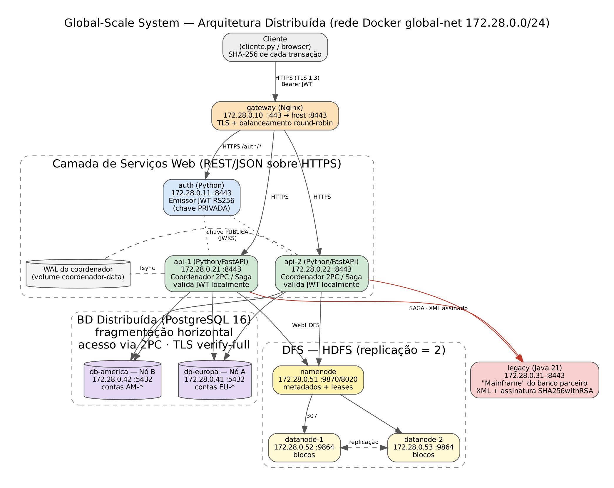

# Global-Scale System

**Uma plataforma distribuída e resiliente para transações financeiras internacionais**

Projeto prático do Exame Laboratorial da disciplina **Sistemas Distribuídos e Paralelos**
(Licenciatura em Engenharia e Ciência dos Computadores — ISUTC).



## Componentes

| Serviço | Tecnologia | IP / Porta | Função |
|---|---|---|---|
| `gateway` | Nginx 1.27 | 172.28.0.10 · host **:8443** | Ponto de entrada HTTPS e balanceamento de carga entre as réplicas |
| `auth` | Python / FastAPI | 172.28.0.11 :8443 | Emissor de tokens **JWT RS256**, com JWKS |
| `api-1`, `api-2` | Python / FastAPI | 172.28.0.21/22 :8443 | Núcleo REST/JSON e coordenadores de **2PC** e **Saga** |
| `db-europa` | PostgreSQL 16 | 172.28.0.41 :5432 | Fragmento A, com as contas `EU-*` |
| `db-america` | PostgreSQL 16 | 172.28.0.42 :5432 | Fragmento B, com as contas `AM-*` |
| `namenode` | Hadoop HDFS 3.3.6 | 172.28.0.51 · host **:9870** | Metadados do DFS |
| `datanode-1/2` | Hadoop HDFS 3.3.6 | 172.28.0.52/53 | Blocos do DFS, com replicação = 2 |
| `legacy` | **Java 21** | 172.28.0.31 :8443 | "Mainframe" do banco parceiro: XML com assinatura digital |

## Requisitos

- Docker Desktop (Windows ou macOS) ou Docker Engine com Compose v2 (Linux)
- Cerca de 4 GB de RAM livres para o Docker
- Portas livres no anfitrião: `8443`, `8080` e `9870`

## Arranque rápido

```bash
git clone <url-do-repositorio> global-scale-system
cd global-scale-system
docker compose up -d --build        # 1.ª vez: 3–6 min (descarrega imagens)
docker compose ps                   # todos "running" / "healthy"
```

O serviço `certs` gera automaticamente a PKI em `./certs`: a CA, os certificados de cada serviço, as chaves JWT e as chaves de assinatura. Esta pasta **não é versionada**.

> Espere cerca de **60 segundos** depois do arranque para o HDFS sair do *safe mode*. Até lá, os registos de auditoria ficam guardados em memória e são enviados automaticamente quando o HDFS estiver pronto.

Interfaces disponíveis:

- **API (Swagger):** https://localhost:8443/docs. O certificado é da CA própria; pode importar `certs/ca.crt` no browser ou aceitar o aviso.
- **HDFS:** http://localhost:9870, em *Datanodes* e em *Utilities → Browse the file system*.

## Utilizadores de demonstração

| Utilizador | Password | Papel | Contas |
|---|---|---|---|
| ana | `Ana@2026` | cliente | EU-1001 (EUR), EU-1003 (MZN) |
| carla | `Carla@2026` | cliente | EU-1002 (EUR) |
| bruno | `Bruno@2026` | cliente | AM-2001 (USD) |
| diego | `Diego@2026` | cliente | AM-2002 (MZN) |
| admin | `Admin@2026` | admin | todas |

### Moedas e câmbio

Cada conta tem a sua moeda (EUR, USD ou MZN). O valor de uma transferência é indicado na moeda da conta de **origem**; o servidor converte-o para a moeda do destino. As taxas ficam na tabela `taxas_cambio`, **replicada** em todos os nós, e o metical é a moeda de referência (1 EUR = 69,50 MZN; 1 USD = 63,90 MZN). Alterar uma taxa (`gss taxa-atualizar EUR 70.25`, só para o admin) atualiza todas as réplicas com Two-Phase Commit.

## Utilização com o cliente incluído

O cliente corre num contentor, por isso não precisa de Python instalado no anfitrião:

```bash
alias gss="docker compose run --rm cliente"      # PowerShell: function gss { docker compose run --rm cliente @args }

gss login ana Ana@2026
gss contas                                        # consulta scatter-gather aos 2 fragmentos
gss transferir EU-1001 AM-2001 150                # 2PC com conversão: 150 EUR -> 163,15 USD
gss transferir EU-1001 EU-1003 10                 # transação LOCAL: 10 EUR -> 695 MZN
gss taxas                                         # taxas de câmbio em todas as réplicas
gss transferir EU-1001 AM-2001 10 --adulterar     # integridade: SHA-256 rejeita
gss replay EU-1001 AM-2002 5                      # anti-replay
gss token-falso                                   # JWT forjado -> 401
gss ordem EU-1003 MZ59000100000012345678901 20000 # interoperabilidade Python -> Java (Saga), em MZN
gss login admin Admin@2026
gss totais                                        # saldos por moeda e total em MZN
gss taxa-atualizar EUR 70.25                      # replicação síncrona da taxa (2PC)
gss relatorio-gerar && gss relatorios             # ficheiros no HDFS
gss auditoria                                     # registos de auditoria encadeados
gss admin-2pc                                     # estado do coordenador e transações preparadas
```

Exemplo com `curl`:

```bash
TOKEN=$(curl -s --cacert certs/ca.crt https://localhost:8443/auth/login \
  -H 'Content-Type: application/json' -d '{"username":"ana","password":"Ana@2026"}' | jq -r .access_token)
curl -s --cacert certs/ca.crt https://localhost:8443/contas -H "Authorization: Bearer $TOKEN" | jq
```

## Simulação de falhas (demonstração laboratorial)

O guião completo, passo a passo, está em `bash scripts/demo.sh`. Os cenários principais são estes:

| Cenário | Comando | Resultado esperado |
|---|---|---|
| Nó da BD em baixo | `docker compose stop db-america`, depois `gss transferir EU-1001 AM-2001 20` | HTTP 503, transação **ABORTADA** sem movimentar dinheiro. Transferências só na Europa continuam a funcionar |
| Falha de rede na fase 1 | `gss transferir EU-1001 AM-2001 50 --falha participante_indisponivel_fase1` | ABORT global e ROLLBACK do participante já preparado |
| Nó cai na fase 2 | `gss transferir EU-1002 AM-2002 100 --falha atraso_fase2` e, durante a espera, `docker compose kill db-america` | `CONFIRMADA_PENDENTE`. Depois de `docker compose start db-america`, a recuperação faz `COMMIT PREPARED` |
| Crash do coordenador | `gss transferir AM-2001 EU-1003 300 --falha crash_coordenador_fase2` | O contentor morre e o Docker reinicia-o. A recuperação lê o WAL e conclui o commit |
| Réplica da API em baixo | `docker compose stop api-1` | O gateway encaminha tudo para a `api-2` |
| Nó em baixo ao atualizar uma taxa | `docker compose stop db-america`, depois `gss taxa-atualizar EUR 99` | ABORT; **nenhuma** réplica é alterada |
| Legado em baixo | `docker compose stop legacy`, depois `gss ordem ...` | A Saga executa a **compensação** (estorno) |
| DataNode em baixo | `docker compose stop datanode-1` | Os ficheiros continuam legíveis, graças à réplica no `datanode-2` |

Para consultar os saldos e as transações preparadas diretamente nos nós:

```bash
docker compose exec db-europa  psql -U postgres -d banco -c "select id, saldo from contas"
docker compose exec db-america psql -U postgres -d banco -c "select gid, prepared from pg_prepared_xacts"
```

## Estrutura do repositório

```
├── docker-compose.yml          Orquestração de todos os nós e da rede
├── nginx/nginx.conf            Gateway HTTPS e balanceamento
├── config/hadoop.env           Configuração do HDFS
├── db/                         Esquema, fragmentos, TLS e pg_hba do PostgreSQL
├── services/
│   ├── auth/                   Serviço de autenticação (JWT RS256)
│   ├── core/app/
│   │   ├── main.py             Endpoints REST
│   │   ├── transacoes.py       Coordenador 2PC, Saga e recuperação
│   │   ├── shards.py           Encaminhamento para fragmentos e scatter-gather
│   │   ├── security.py         JWT, SHA-256 e assinatura digital
│   │   ├── dfs.py              Cliente WebHDFS e auditoria encadeada
│   │   └── legado.py           Adaptador JSON <-> XML para o mainframe
│   └── legacy-java/            Mainframe do banco parceiro (Java 21)
├── scripts/
│   ├── gen-certs.sh            PKI (CA e certificados)
│   ├── cliente.py              Cliente de linha de comandos
│   └── demo.sh                 Guião da demonstração
└── docs/arquitetura.(png|svg|dot)
```

## Resolução de problemas

- **`bad interpreter` ou `\r` nos scripts (Windows):** o `.gitattributes` força fins de linha LF. Se copiou os ficheiros sem usar o git, converta-os com `dos2unix db/*.sh scripts/*.sh`.
- **HDFS "Safe mode" ou auditoria pendente:** espere 1 minuto. `gss saude` mostra `dfs_auditoria_pendente`.
- **Mac com Apple Silicon:** a imagem `apache/hadoop:3.3.6` é amd64 e corre por emulação. É mais lenta, mas funciona.
- **Recomeçar do zero:** `docker compose down -v && rm -rf certs && docker compose up -d --build`.
